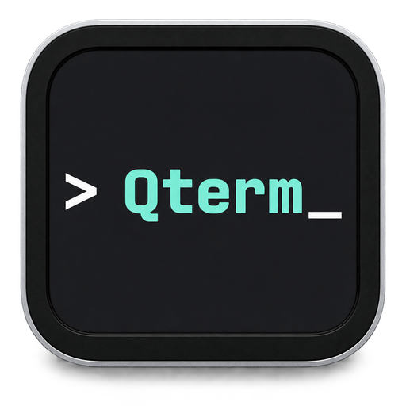
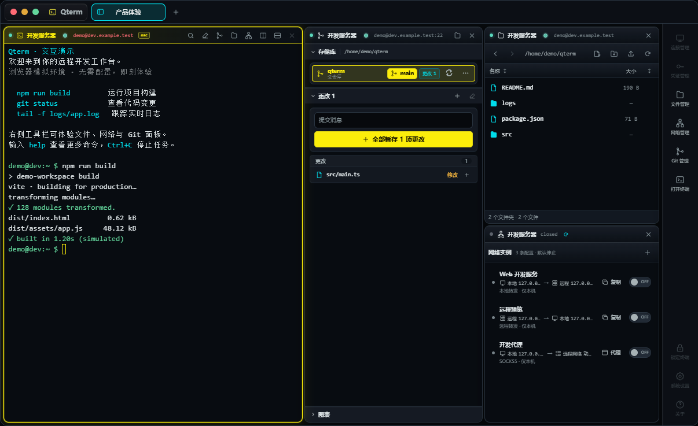

<div align="center">
  
  <h1>Qterm</h1>
  <p>An open-source SSH workspace for remote AI development</p>
  <p><a href="README.md">简体中文</a> · English</p>
  <p>
    <a href="https://github.com/qiubai-lab/Qterm/releases/latest"></a>
    <a href="LICENSE"></a>
    
  </p>
  <p><a href="https://qiubai-lab.github.io/Qterm/en/">Website</a> · <a href="https://qiubai-lab.github.io/Qterm/demo/">Live demo</a> · <a href="https://qiubai-lab.github.io/Qterm/en/download/">Download</a></p>
</div>

Qterm brings local terminals, SSH sessions, SFTP files, Git review and port forwarding into split workspaces. It is built with Tauri 2, React, TypeScript and Rust.



The current application and browser demo interface are in Chinese. The English website and guides explain how to use the workspace.

## Remote AI development

Run Claude Code, Codex or another CLI agent on your SSH server. Qterm does **not** bundle a model or agent; install and authenticate your chosen CLI separately.

- **Send local context:** paste a screenshot, file or folder into a remote terminal. Qterm uploads it through the SSH session and inserts the remote path without executing a command.
- **Inspect files alongside the agent:** browse, upload, download, preview and edit through SFTP.
- **Follow the terminal directory:** when OSC 7 directory reporting is enabled, open Files or Git at the reported location. You can also choose the path manually.
- **Review remote changes:** inspect diffs, selectively stage files, commit and manage branches, synchronization and conflicts in the selected local or remote repository.
- **Organize projects:** split Terminal, Files, Git and Network Blocks and switch workspaces while active sessions stay in place. This does not promise recovery after disconnection or application exit.

Start with [the remote AI workflow](https://qiubai-lab.github.io/Qterm/en/guides/remote-ai/) and [the image/file paste guide](https://qiubai-lab.github.io/Qterm/en/guides/remote-agent-files/).

## Try before installing

The [browser demo](https://qiubai-lab.github.io/Qterm/demo/) uses fictional sessions, files and repositories. It does not connect to servers, run real shell commands or establish tunnels. It demonstrates layout, simulated terminal input, file editing, Git staging/commits and themes; it does not simulate every desktop feature. See [demo scope](docs/browser-demo.md) (Chinese).

## Install

See the [installation guide](https://qiubai-lab.github.io/Qterm/en/download/) or download from [GitHub Releases](https://github.com/qiubai-lab/Qterm/releases/latest).

### macOS

The project-maintained Homebrew tap supports Apple Silicon and Intel:

```sh
brew tap qiubai-lab/tap
# One-time trust step for Homebrew 6.0+; skip on older versions.
brew trust qiubai-lab/tap
brew install --cask qterm
```

The app is not currently notarized by Apple. The cask removes Qterm’s quarantine attribute during installation; review the [tap](https://github.com/qiubai-lab/homebrew-tap) before trusting it. For manual DMG installation and first-launch troubleshooting, see the [Chinese README](README.md#macos).

Update with:

```sh
brew update
brew upgrade --cask qterm
```

### Windows and Linux

Choose an x64 `.msi` or NSIS `.exe` installer for Windows. On Linux, use `.deb`, `.rpm`, or an `.AppImage` with executable permission. New versions are published as release assets.

### Self-hosted Web runtime

A separate single-user Web runtime can run in your own Docker environment. The published image targets AMD64 Linux; it uses host networking and runs as root by default. HTTP is intended for trusted networks or VPNs; configure HTTPS for public access. Follow the [container deployment guide](docs/container-deployment.md) (Chinese) for setup, authentication, persistence, upgrades and backups.

## Connections and security

Qterm supports one-time passwords, saved encrypted credentials, private keys and SSH Agent. First connections require host-key fingerprint confirmation; changed trusted keys are blocked by default. The credential vault uses Argon2id-derived keys and AES-256-GCM encryption, with an offline recovery key.

OSC 7 integration installs temporary session hooks without editing shell startup files, but those commands can appear in shell history. Disable directory tracking in advanced settings if you do not want the hooks. See the [security model](docs/security-model.md) and [troubleshooting](docs/troubleshooting.md) for limitations (Chinese).

## Development and contributions

Use the pinned toolchain and platform prerequisites in the [development guide](docs/DEVELOPMENT.md):

```sh
pnpm install --frozen-lockfile
pnpm tauri dev
```

`pnpm dev` starts only the browser frontend and does not provide native SSH/SFTP IPC. `pnpm dev:demo` starts the simulated demo. Run `pnpm check` for frontend verification; see [AGENTS.md](AGENTS.md) for backend checks and contribution conventions.

Issues, documentation improvements and pull requests are welcome. Include regression coverage for authentication, host keys, persistence, layouts and transfers. Attach screenshots or recordings for UI changes.

## License

Qterm is licensed under [GNU GPL version 3 only](LICENSE), SPDX identifier `GPL-3.0-only`. Consult the license for modification and redistribution requirements.
